<div align="center">

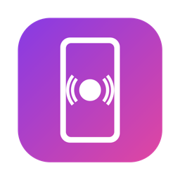

# Meroro

**The all-in-one desktop streaming studio for phone and PC gamers.**<br/>
Mirror your Android phone or iPhone, play with keyboard and mouse, build animated scenes and go live on 14 platforms at once, from one app.

<p>
  
  
  
  
  
  
</p>

<p>
  <a href="#-highlights">Highlights</a> ·
  <a href="#-features">Features</a> ·
  <a href="#-getting-started">Getting started</a> ·
  <a href="#-how-it-works">How it works</a> ·
  <a href="#-development">Development</a> ·
  <a href="#-faq">FAQ</a>
</p>

<sub>Designed and built by <b>Kartik Sabale</b></sub>

<br/><br/>

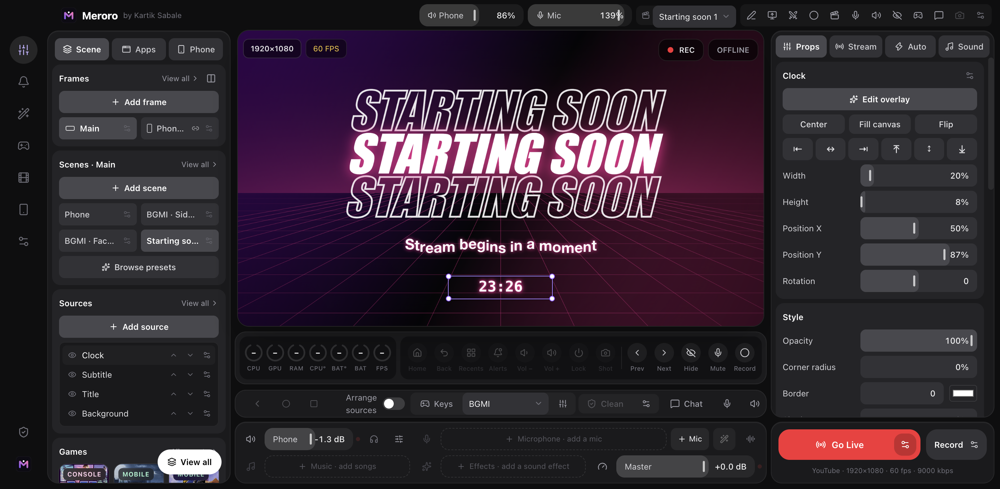

</div>

---

## Why Meroro

Streaming a mobile game usually takes a capture card or a mirroring app, then OBS, overlay plugins, a key mapper, a voice changer and a restream service. Meroro does all of that in one app.

| | |
|---|---|
| 📱 **Plug in and it's detected** | No capture card and nothing to install on an Android phone. On iPhone, use a USB cable (Mac) or AirPlay. |
| 🎯 **Stream one app, not your phone** | Pick your game and only that game goes on stream. Notifications and other apps are covered. |
| 🎮 **Play with keyboard, mouse or pad** | Emulator-style key maps with WASD, mouse aim, a free cursor and screen triggers. |
| 🌈 **Overlays included** | 56 name banners, 60 animated stream scenes, 20 alert effects and 24 caption styles. |
| 📡 **Every platform at once** | YouTube, Twitch, Kick, Instagram, TikTok and 9 more, each with its own scene, size and quality. |
| 🎙️ **Studio-grade audio** | Multi-mic mixer, 42 natural voices, 16 sound effects and offline live captions. |

## 🌟 Highlights

<table>
<tr>
<td width="32%" valign="top">
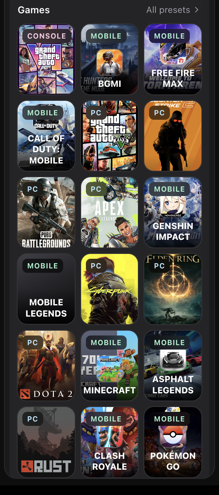
</td>
<td width="68%" valign="top">

### 🕹️ Games library
Posters for 18 popular games sit at the bottom of the Scene tab. Each card is tagged **Mobile**, **PC** or **Console**. Click one to see its stream presets.

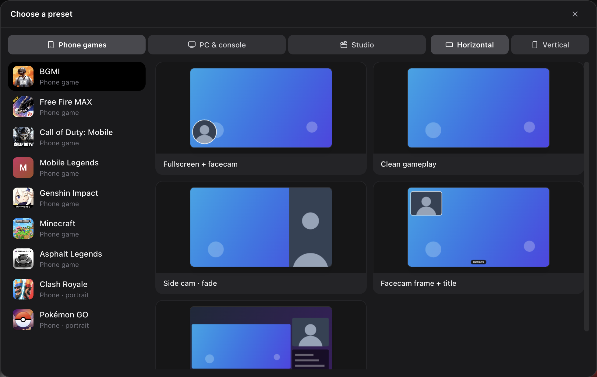

### 🎨 One-click presets
Phone games, PC & console and Studio layouts, in horizontal or vertical: fullscreen with facecam, clean gameplay, side cam with fade, facecam frame with title, and more.

</td>
</tr>
</table>

<table>
<tr>
<td width="50%" valign="top">

### 🎙️ Voice changer
42 natural voices (female, male, kids, characters, robots, radio) powered by Signalsmith Stretch. Record a 4-second test and preview any voice, or build and save your own with pitch, character, robot, echo and room.

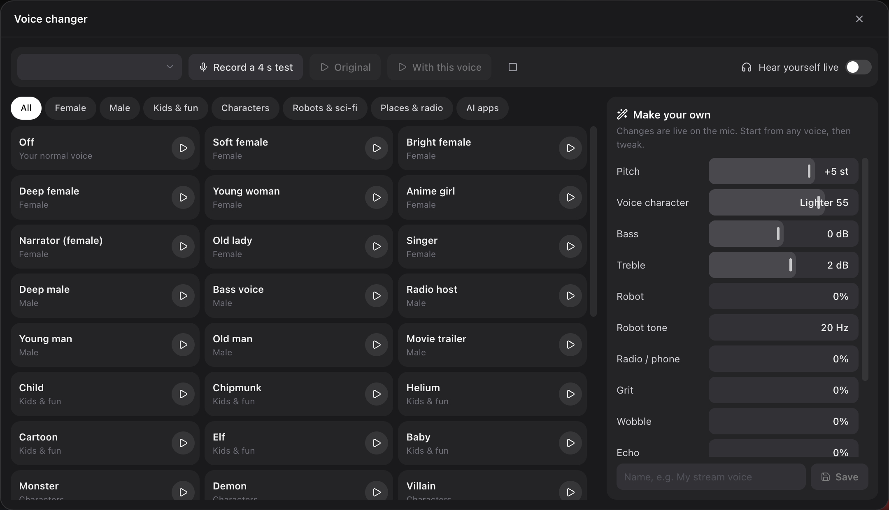
</td>
<td width="50%" valign="top">

### 📡 14 streaming platforms
YouTube (several accounts), Twitch, Kick, Facebook, Instagram, TikTok, X, Trovo, Rumble, Loco, DLive, LinkedIn, Vimeo and any custom RTMP server. Stream to all of them at the same time.

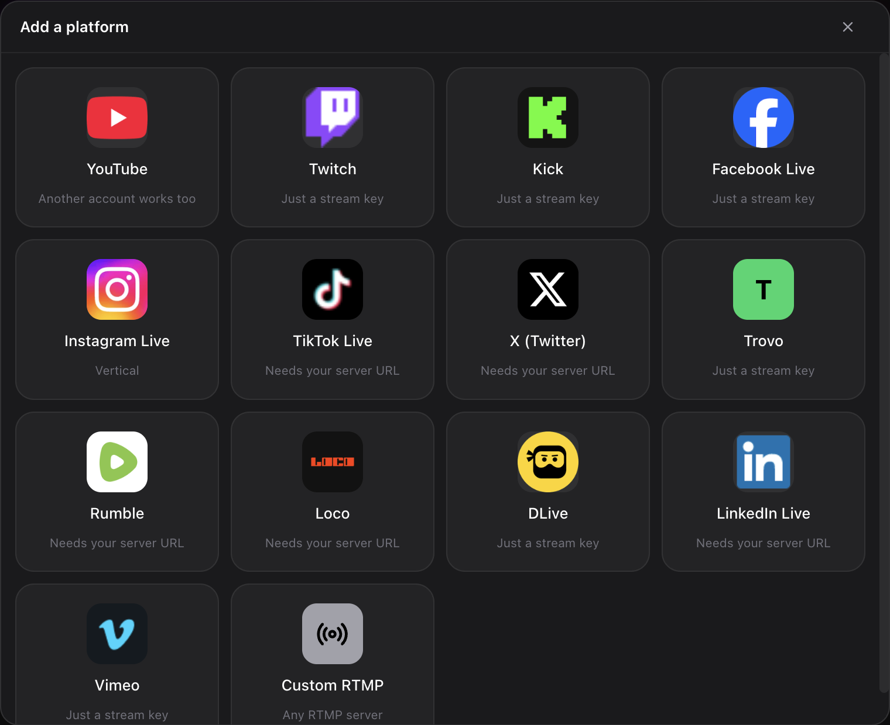
</td>
</tr>
<tr>
<td width="50%" valign="top">

### 🌈 Animated overlays
Starting soon, Be right back and Ending scenes with moving backgrounds. Every preset is editable and imported in one click.

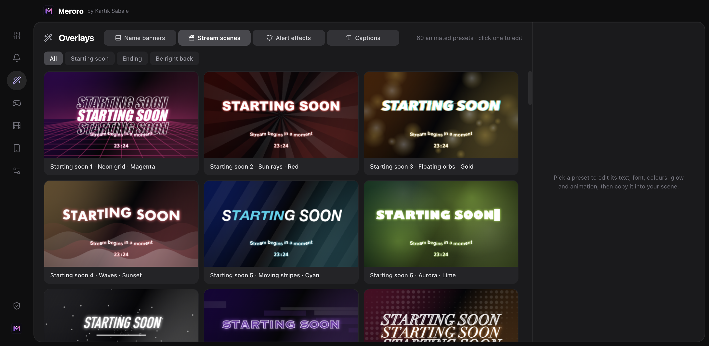
</td>
<td width="50%" valign="top">

### 💬 Live captions + styles
Free, offline speech-to-text in English, Hindi, Hinglish, Gujarati and Telugu, with 24 caption styles such as karaoke, word box, neon and movie subtitle.

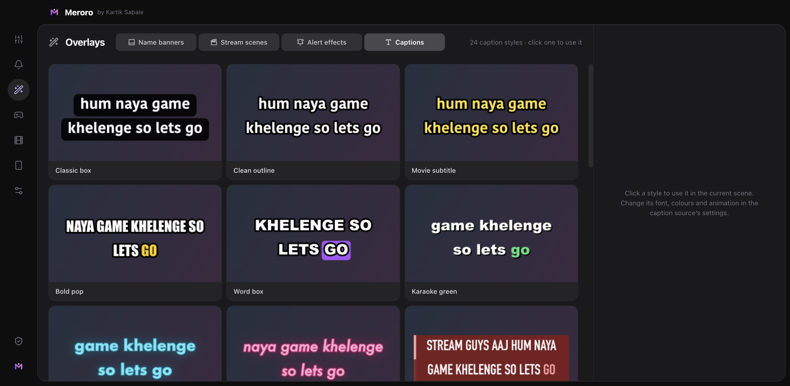
</td>
</tr>
<tr>
<td width="50%" valign="top">

### ✏️ Annotation tools
Draw on the stream or over your whole screen: pen, highlighter, shapes, arrows, text, numbered steps, laser pointer, spotlight, timer and boards (white, black, chalk, grid). Built for teaching live.

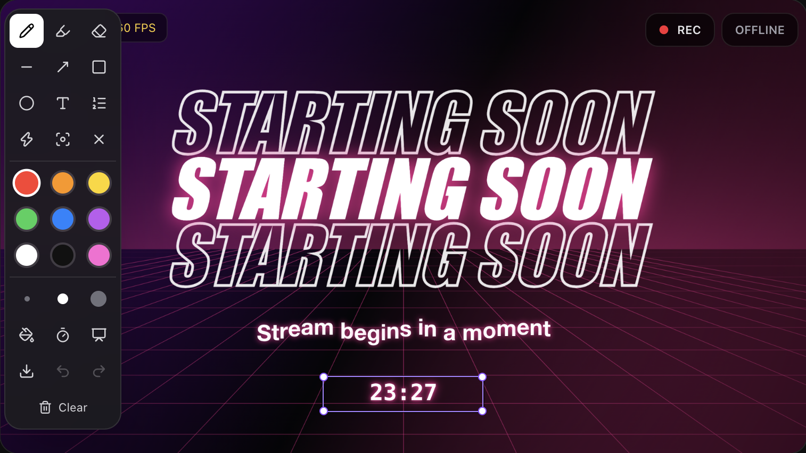
</td>
<td width="50%" valign="top">

### ✨ Alert effects
Confetti, coin rain, neon, glitch and more. They play for Super Chats, members, chat messages, stream start and subscribe reminders.

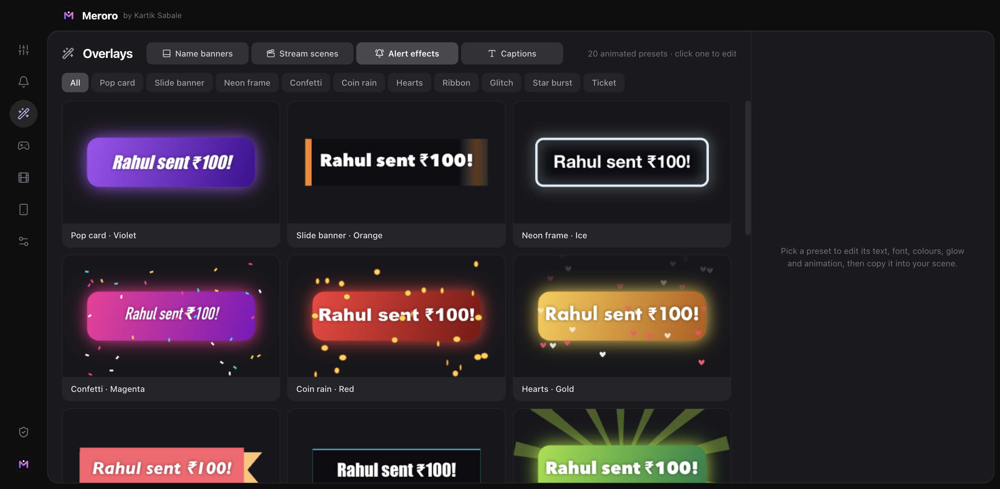
</td>
</tr>
<tr>
<td width="50%" valign="top">

### 🔴 Go Live + Record
Pick which platforms go live from the Go Live button. Record in 2K or 4K, the whole studio or just one frame or scene.

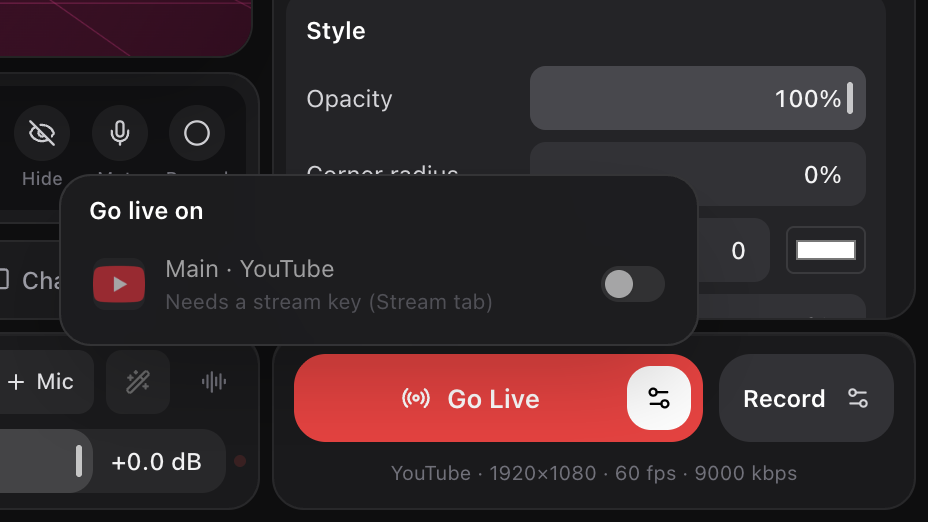
</td>
<td width="50%" valign="top">

### 🎬 Recording settings
Choose what to record, the size and the quality, then open the take in the built-in editor for auto zooms, cuts and MP4 / GIF export.

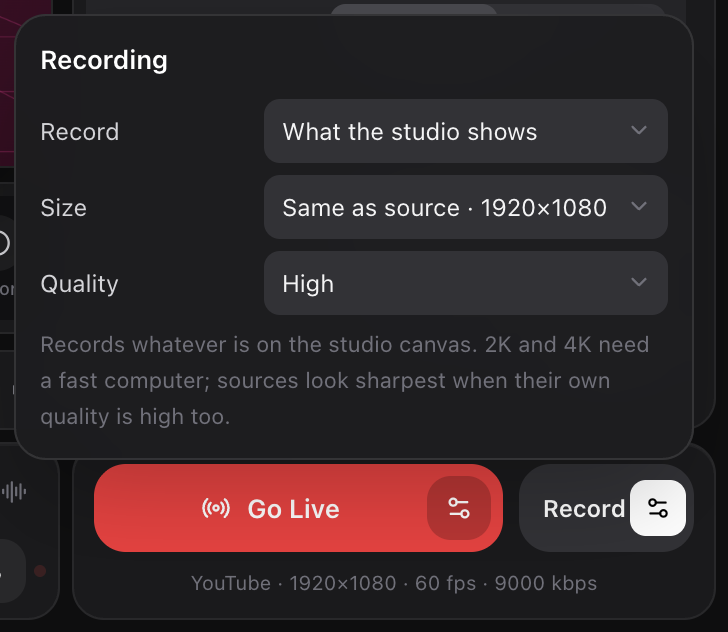
</td>
</tr>
<tr>
<td width="50%" valign="top">

### 🗂️ Frames, scenes & sources
One stacked tree of every frame, scene and source. Search, hide, reorder and open settings without leaving the studio.

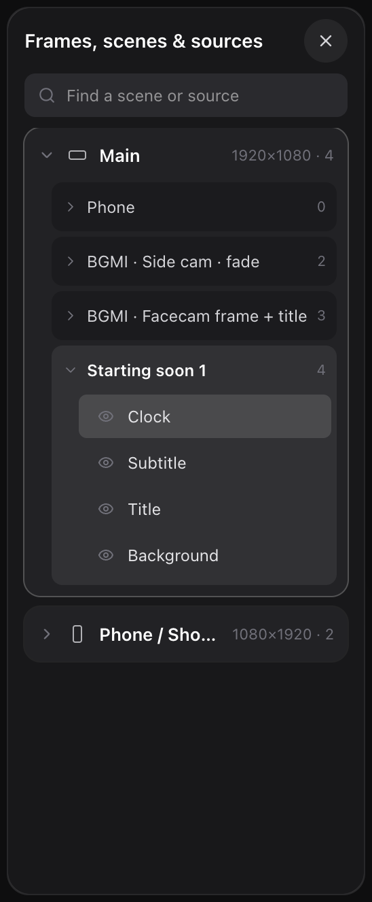
</td>
<td width="50%" valign="top">

### ⚡ Header quick controls
The controls you use most sit in the title bar: phone and mic volume, scene switcher, annotate, screen draw, pointer, record, captions and more. Choose which ones show.

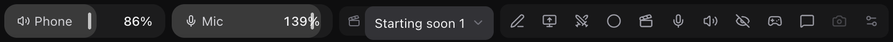
</td>
</tr>
</table>

## ✨ Features

<table>
<tr>
<td width="50%" valign="top">

### 📱 Phone capture
- **Android:** the open-source **scrcpy** server over ADB. H.264 up to 1080p60, phone audio on Android 11+, USB or Wi-Fi.
- **iPhone / iPad:** USB capture on Mac (the same way QuickTime does it) and a built-in **AirPlay receiver**.
- **Clean screen:** hides notifications, Game Booster pop-ups and floating apps while you stream, then restores them.
- **Landscape lock:** when the phone turns upright, show a scene you choose, such as *Be right back*.
- **Phone controls:** Home, Back, Recents, volume, lock, screenshot, refresh and restart.
- **Phone stats:** live CPU, GPU, RAM, temperatures and battery in ring gauges.

### 🎯 Single-app streaming
- **Play on phone:** anything that isn't the selected app is covered on stream.
- **Isolated:** run the app on a private virtual display and play it from the preview.
- **Use current app:** swap a source to whatever is open on the phone in one click.

### 🎮 Key mapping
- Taps, hold / toggle / repeat, joystick, mouse aim, free look, skill cast and macros.
- **Free cursor** when the map, bag or a crate is open, and **screen triggers** that react to what's on screen.
- **Controller support** for Xbox and PlayStation pads, including analog sticks.

### 🙂 Face tracking (webcam)
- **Auto center** and **zoom when talking**, with smooth spring motion.
- **Face blur** and **hide when away**.
- A side cam layout at full height with an edge fade.

</td>
<td width="50%" valign="top">

### 🎬 Frames, scenes & sources
- **Frames** hold scenes for each aspect ratio: 16:9, 9:16, 1:1, 4:5 and more. Each frame can stream to its own platforms at the same time.
- **Linked frames:** a child frame follows its parent's scenes but keeps its own layout.
- **Frames side by side** in a separate, bezel-less window.
- Sources: Phone, iPhone, Webcam, Screen / Window, Image, Video, Web page, chat, alerts, text, clock, lower third, goal bar, blur box, captions, mic and nested scene.
- **Zoom inside a source** and **move inside** it, plus fit / fill / stretch, crop, green screen, LUTs, radius, border and shadow.
- **Undo / redo** (100 steps), snap guides and align buttons.

### 🔴 Live & record
- **14 platforms** and **simultaneous streams**, including several YouTube accounts.
- Scene, size, bitrate and quality per stream, with per-stream status.
- **VideoToolbox** hardware encoding, auto-reconnect, auto bitrate and a health graph.
- Record in up to **4K**: the whole studio, one frame or one scene.
- **Recording editor:** auto zooms on clicks, styled backgrounds, cuts, speed and notes, then export as MP4 or GIF.

### 🎙️ Audio
- **Advanced mixer:** gain, delay, noise gate, EQ, compressor and pan for each channel.
- **Multiple mics** as scene sources, plus **RNNoise** noise removal.
- **Voice changer** with 42 voices, custom voices and AI voice changer apps (virtual mic).
- **16 sound effects**, background music that ducks under your voice, push-to-talk and a soundboard.

### ⚙️ Automation & settings
- **Switch scene when you talk**, open a game or go home.
- **Scene hotkeys** that work while you're in a game.
- **Profiles** with export and import, and **Reset everything**.
- Animated stream pointers and the YouTube chat overlay with bot replies.

</td>
</tr>
</table>

Every feature is listed on the **What's new** page in the app, with a button that takes you to it. Meroro checks GitHub for new versions and updates itself.

### 🕹️ Ready-made game maps & presets

| Game | Key map | Stream presets |
|---|---|---|
| **BGMI** | WASD + Shift sprint, mouse aim, peek, lean, heal, grenade, vehicle | Fullscreen + facecam · Clean · Side cam · Title frame · Shorts |
| **Free Fire MAX** | WASD, mouse aim, gloo wall, skill, med kit | Fullscreen + facecam · Side cam |
| **Call of Duty: Mobile** | WASD, mouse aim, slide, lethal, tactical, operator skill, scorestreak | Fullscreen + facecam · Side cam |
| **GTA VI · GTA V** | — (PC / console capture) | Vice sunset side cam · Sunset glow · Cinematic bars · Top / bottom bar |
| PC games: CS2, PUBG, Apex, Cyberpunk 2077, Elden Ring, Dota 2, Rust | — | Game + cam layouts |
| More mobile games: Genshin, Mobile Legends, Minecraft, Asphalt, Clash Royale, Pokémon GO | Generic maps | Horizontal and portrait layouts |

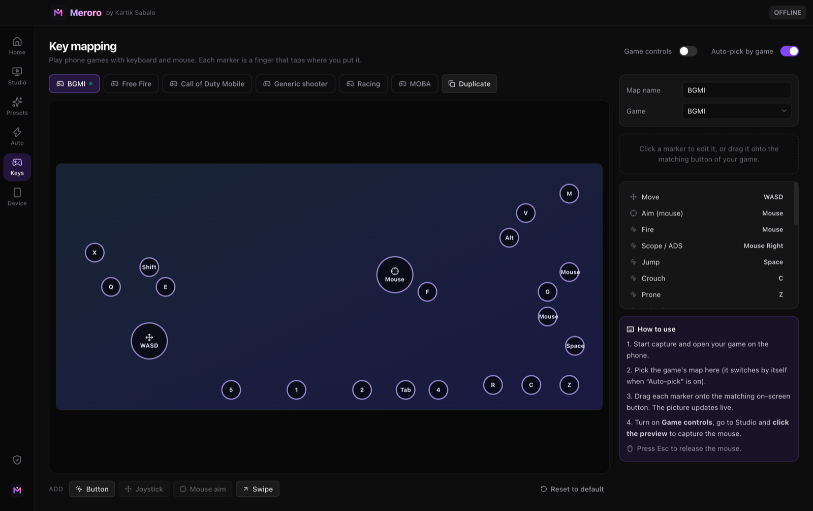

## 🚀 Getting started

### Requirements
- macOS 12+ (Apple Silicon or Intel) or Windows 10/11.
- **Android:** a phone with **USB debugging** turned on (*Settings → Developer options*).
- **iPhone:** a cable (Mac only) or the same Wi-Fi network for AirPlay. The AirPlay receiver ([UxPlay](https://github.com/FDH2/UxPlay)) is installed from *Add source* with one click on Mac. On Windows, install UxPlay through MSYS2.

### Go live in five steps
1. Plug in your phone and tap **Allow** (Android) or **Trust** (iPhone).
2. Pick your game from the **Games** library, or press **+** in Sources.
3. Choose a preset, or import a scene from **Overlays**.
4. In the **Stream** tab, press **+** to add platforms and paste their stream keys.
5. Press **Go Live**. Use the button's settings icon to pick which platforms go live.

## ⌨️ Keyboard shortcuts

| Shortcut | Action |
|---|---|
| <kbd>⌘</kbd>/<kbd>Ctrl</kbd> + <kbd>1</kbd>–<kbd>9</kbd> | Switch scene (custom hotkeys in **Settings**) |
| <kbd>⌘</kbd>/<kbd>Ctrl</kbd> + <kbd>Z</kbd> | Undo |
| <kbd>⌘</kbd>/<kbd>Ctrl</kbd> + <kbd>Shift</kbd> + <kbd>Z</kbd> | Redo |
| <kbd>⌘</kbd>/<kbd>Ctrl</kbd> + <kbd>R</kbd> | Start / stop recording |
| <kbd>←</kbd> <kbd>→</kbd> <kbd>↑</kbd> <kbd>↓</kbd> | Nudge the selected source |
| <kbd>Delete</kbd> | Remove the selected source |
| Scroll on preview | Scale the selected source |
| Right-click (control mode) | Phone *Back* |

Push-to-talk and soundboard keys are set in the **Sound** tab.

## 🧠 How it works

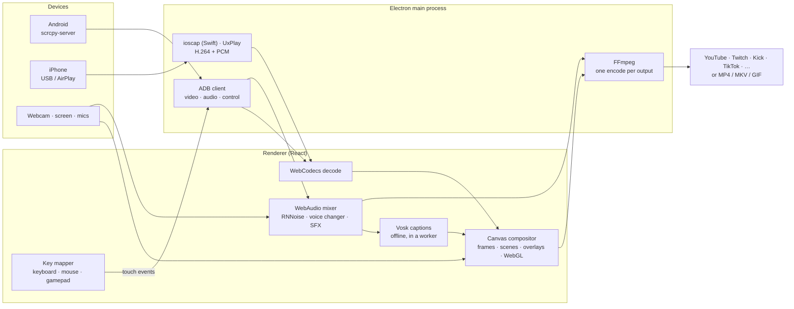

- **No middleman apps.** Meroro speaks the scrcpy protocol itself. It pushes the server, opens the video, audio and control sockets, and injects touches for key maps.
- **iPhone over USB.** A small Swift helper (`native/ioscap.swift`) turns on iOS screen capture devices, encodes them with VideoToolbox and sends H.264 and PCM to the app. AirPlay comes from UxPlay through local RTP.
- **Hardware decode.** Video goes into `VideoDecoder` and onto a canvas that composes every layer at the stream frame rate. Chroma key and LUTs run in WebGL.
- **One canvas per frame.** Each frame is composed once and sent to FFmpeg for every platform that streams it, so simultaneous streams don't multiply the work.
- **Audio graph.** Each channel runs gain → delay → noise gate → EQ → compressor → pan. The voice changer is [Signalsmith Stretch](https://github.com/Signalsmith-Audio/signalsmith-stretch) in an AudioWorklet.
- **Captions offline.** [Vosk](https://alphacephei.com/vosk/) runs in a Web Worker. The model is downloaded once per language and then works without internet.

## 🛠️ Development

```bash
git clone https://github.com/kali23041/Meroro.git && cd Meroro
npm install          # also downloads adb, scrcpy-server, ffmpeg and builds ioscap on Mac
npm run dev
```

> If install scripts were skipped, run `node scripts/fetch-bins.mjs` once.

### Build installers
```bash
npm run dist:mac     # → dist/Meroro-<version>-mac-arm64.dmg  (on macOS)
npm run dist:win     # → dist/Meroro Setup <version>.exe      (on Windows)
```

Publish a GitHub release tagged `v<version>` with the installers attached, and existing installs will offer the update. Add new features to `RELEASES` in `src/renderer/src/WhatsNew.jsx`.

### Project structure

```
src/
├── main/                    Electron main process
│   ├── index.js               windows, IPC, FFmpeg outputs, updates, meroro:// protocol
│   ├── phone.js               ADB + scrcpy client, phone stats, clean screen
│   ├── ios.js                 iPhone USB capture, AirPlay receiver, RTP depacketizer
│   ├── chat.js                YouTube live chat reader and replies
│   └── splash.js              setup splash with progress
├── preload/                 secure IPC bridge
└── renderer/src/            React UI
    ├── App.jsx                studio layout, live logic, hotkeys, undo / redo
    ├── engine.js              decode, compositor, mixer, face tracking, outputs
    ├── scene.js · framemodel.js   scenes, frames, linked frames, game presets
    ├── Frames.jsx · Manager.jsx   frames panel, side-by-side window, view-all tree
    ├── GamesLibrary.jsx · PresetPicker.jsx
    ├── Mixer.jsx · voice.js · VoiceLab.jsx · sfx.js
    ├── captions.js · CaptionStyles.jsx · capfx.js
    ├── StreamTabs.jsx · platforms.js   platform tabs, library, Go Live bar
    ├── Annotate.jsx · ScreenOverlay.jsx · pointerfx.js
    ├── Editor.jsx · EditorWindow.jsx · edit.js   recording editor
    ├── Overlays.jsx · fx.js · gpu.js
    ├── keymap.js · Keys.jsx · Face.jsx · Settings.jsx · Perf.jsx
    └── WhatsNew.jsx           release notes and updater
native/ioscap.swift          iPhone USB capture helper (macOS)
scripts/fetch-bins.mjs       downloads binaries, builds ioscap, draws the icon
```

### Tech stack

Electron · React 19 · Tailwind CSS v4 · Radix UI · Lucide · electron-vite · electron-builder · WebCodecs · WebGL · WebAudio · RNNoise · Signalsmith Stretch · Vosk · FFmpeg · scrcpy · ADB · AVFoundation / VideoToolbox · UxPlay

## ❓ FAQ

<details>
<summary><b>Do I need to install anything on my phone?</b></summary>
No. On Android, Meroro pushes the scrcpy server over ADB each time it connects. On iPhone, mirroring uses built-in iOS features.
</details>

<details>
<summary><b>Can I stream to YouTube and Twitch at the same time?</b></summary>
Yes. Add each platform with <b>+</b> in the Stream tab. Each one can use its own frame (for example 16:9 for YouTube and 9:16 for TikTok), bitrate and quality. Choose which ones go live from the Go Live button.
</details>

<details>
<summary><b>Are live captions free? Do they need internet?</b></summary>
They're free and run on your computer. The language model downloads once (about 40 MB), and after that captions work offline.
</details>

<details>
<summary><b>Why is there no phone audio?</b></summary>
Android phone audio needs Android 11 or later. With iPhone USB capture, the audio comes with the video.
</details>

<details>
<summary><b>macOS asks for camera / screen / local network access. Why?</b></summary>
iPhone USB capture is treated as a camera by macOS. Screen and window sources need Screen Recording. Wi-Fi ADB and AirPlay need Local Network access.
</details>

<details>
<summary><b>Does Clean screen change my phone's settings permanently?</b></summary>
No. Meroro saves the previous settings and puts them back when you turn Clean screen off.
</details>

## 🙏 Credits

- Android capture uses the server from [**scrcpy**](https://github.com/Genymobile/scrcpy) by Genymobile (Apache 2.0).
- The AirPlay receiver is [**UxPlay**](https://github.com/FDH2/UxPlay) (GPL-3.0). It is installed separately and not bundled.
- The voice changer uses [**Signalsmith Stretch**](https://github.com/Signalsmith-Audio/signalsmith-stretch) (MIT).
- Live captions use [**Vosk**](https://alphacephei.com/vosk/) through [vosk-browser](https://github.com/ccoreilly/vosk-browser) (Apache 2.0).
- Noise suppression uses [RNNoise](https://github.com/xiph/rnnoise) through [web-noise-suppressor](https://github.com/sapphi-red/web-noise-suppressor).
- FFmpeg comes from [ffmpeg-static](https://github.com/eugeneware/ffmpeg-static). ADB comes from the Android SDK Platform-Tools.
- Game posters are fetched at runtime from public sources and are not bundled. Game names, YouTube, Twitch and the other platforms, iPhone and AirPlay are trademarks of their owners. Meroro is an independent project and is not affiliated with them.

## 📄 License

Meroro is released under the [MIT License](LICENSE). Third-party components listed in Credits keep their own licenses.

## 📬 Contact

**Kartik Sabale** · [kartiksabale.com](https://kartiksabale.com) · [hello@kartiksabale.com](mailto:hello@kartiksabale.com)

---

<div align="center">


**Meroro** · Created by **Kartik Sabale** · © 2026

</div>
