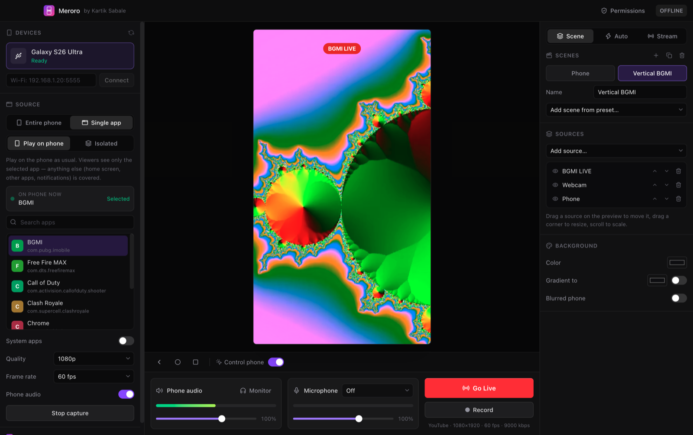
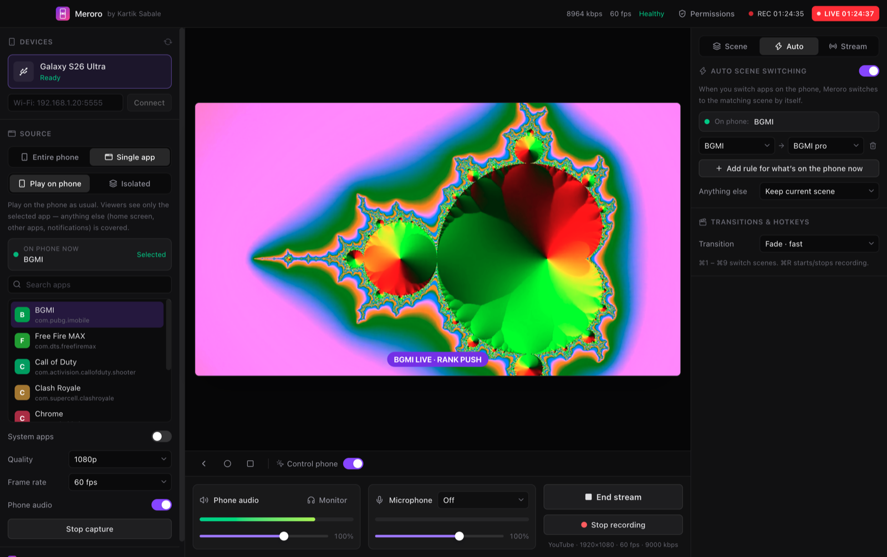
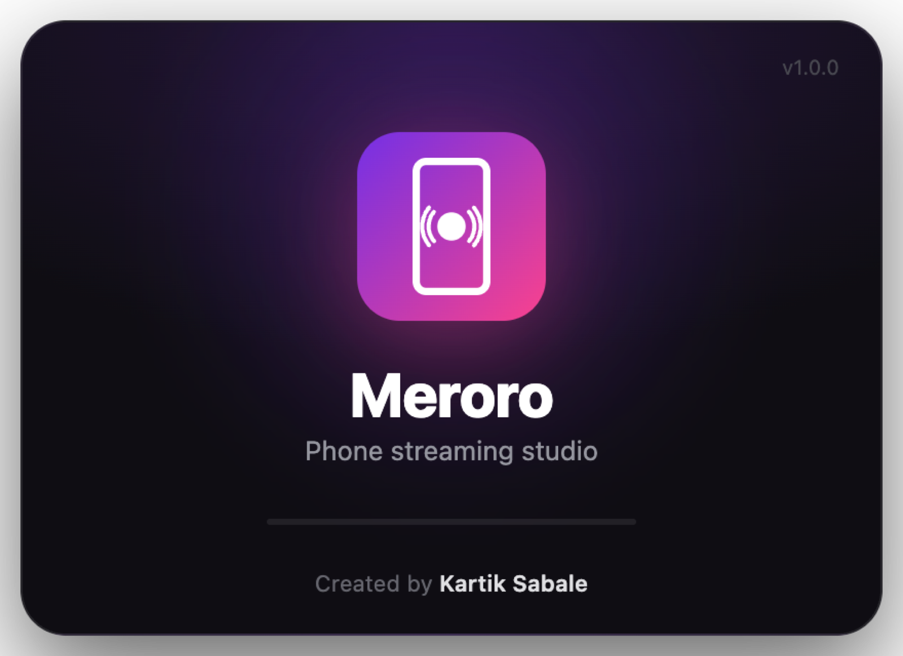
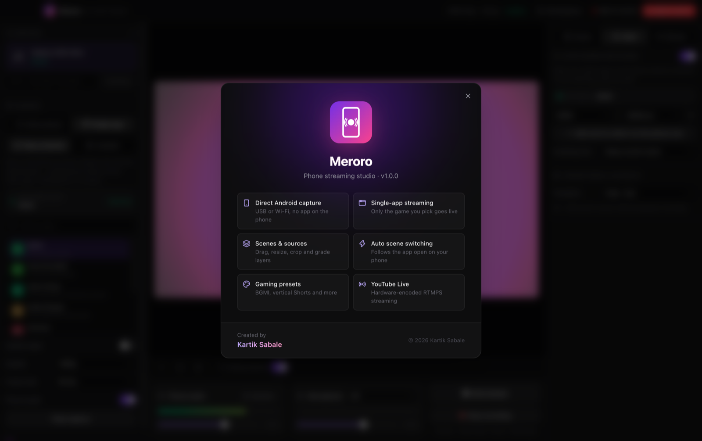
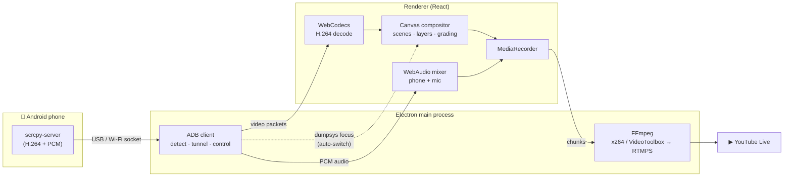

<div align="center">


# Meroro

**A desktop streaming studio for your Android phone.**<br/>
Mirror your phone, or just one game, compose scenes, and go live on YouTube from a single app.

<p>
  
  
  
  
  
  
</p>

<sub>Designed and built by <b>Kartik Sabale</b></sub>

<br/><br/>


</div>

---

## Why Meroro

Streaming a mobile game usually means juggling a capture card or a mirroring app, plus OBS, plus scene plugins. And the whole phone goes on stream, notifications included. Meroro puts all of that in one native-feeling desktop app:

- **Plug in, it's detected.** No app to install on the phone and no capture card.
- **Stream one app, not your whole phone.** Pick BGMI and only BGMI is shown; the home screen, other apps and notifications are covered automatically.
- **Scenes that switch themselves.** Open the game and the gameplay scene comes up; go to the home screen and "Be right back" appears.

## Features

<table>
<tr>
<td width="50%" valign="top">

### 📱 Direct phone capture
Talks straight to the open-source **scrcpy** server over ADB: H.264 video up to 1080p60, raw phone audio (Android 11+), USB or Wi-Fi. Phones appear in the sidebar on their own.

### 🎯 Single-app streaming
- **Play on phone:** keep playing on the device; anything that isn't the selected app is covered on stream.
- **Isolated:** runs the app on a private virtual display and you control it from the preview.
- **On phone now:** shows the app in front, with a one-click *Stream this* button.

### ⚡ Auto scene switching
Rules map apps to scenes (*BGMI → Gameplay*, *Home screen → BRB*), with a fallback scene and Cut or Fade transitions.

</td>
<td width="50%" valign="top">

### 🎬 Scenes & sources
Any number of scenes, each a stack of layers: **Phone, Webcam, Screen/Window, Image, Video, Web page (alerts/chat), Text, Clock, Color/Gradient.**

### ✋ Drag-to-arrange canvas
Move, resize and scale sources right on the preview, with center snapping, arrow-key nudge and Delete to remove.

### 🎨 Adjustments & color grading
Position, size, rotation, opacity, **corner radius**, border, shadow, crop and flip. Looks: *Vivid, Punchy, Cinematic, Warm, Cool, B&W, Faded*, plus brightness, contrast, saturation, hue, warmth and blur.

### 🔴 Go live & record
YouTube Live over RTMPS (or any RTMP server), with **VideoToolbox** hardware encoding on Mac and live bitrate, fps and health stats. Local MKV recording runs alongside.

</td>
</tr>
</table>

### 🎮 Presets, one click away

| Gaming (16:9) | Vertical (9:16 Shorts / Reels) | Studio |
|---|---|---|
| BGMI · Fullscreen + facecam | Phone fullscreen | Phone · blurred backdrop |
| BGMI · Clean gameplay | Phone framed + facecam | Just chatting · cam + phone |
| BGMI · Facecam frame + title | BGMI zoomed + facecam | Starting soon (live clock) |
| Free Fire / COD · Fullscreen + facecam | Game top, cam bottom | Be right back |
| Portrait game · centered + facecam | Game + chat/alerts | |
| BGMI · Shorts vertical | Just chatting | |

Gaming presets also set the capture and stream to 60 fps and 9000 kbps.

## Screenshots

<table>
<tr>
<td width="50%"><p align="center"><sub><b>Vertical streaming</b>: 1080×1920 canvas for Shorts and Reels</sub></p></td>
<td width="50%"><p align="center"><sub><b>Auto scene switching</b>: rules follow the app on the phone</sub></p></td>
</tr>
<tr>
<td width="50%"><p align="center"><sub><b>Launch splash</b></sub></p></td>
<td width="50%"><p align="center"><sub><b>About</b></sub></p></td>
</tr>
</table>

<sub>The phone feed in these screenshots is a generated demo pattern.</sub>

## How it works



- **No middleman apps.** Meroro speaks the scrcpy wire protocol itself: it pushes the server jar, opens the video, audio and control sockets, and parses the packet headers.
- **Hardware decode.** Phone video goes straight into the browser engine's `VideoDecoder`, then onto a canvas that composes every layer at the stream frame rate.
- **One encode for the stream.** The composed canvas and mixed audio are captured once and handed to FFmpeg, which re-encodes them to YouTube's spec (H.264 High, AAC, 2-second keyframes).
- **Foreground tracking.** Meroro polls which app is in front on the phone; that drives both the single-app privacy cover and auto scene switching.

## Getting started

### Requirements
- macOS (Apple Silicon or Intel) or Windows 10/11
- Node.js 20+
- An Android phone with **USB debugging** on (*Settings → Developer options*)

### Run from source
```bash
git clone <your-repo-url> meroro && cd meroro
npm install          # also downloads adb, scrcpy-server and ffmpeg into bin/
npm run dev
```

> If `npm install` skipped install scripts, run `node scripts/fetch-bins.mjs` once.

### Build installers
```bash
npm run dist:mac     # → dist/Meroro-<version>-arm64.dmg   (run on macOS)
npm run dist:win     # → dist/Meroro Setup <version>.exe   (run on Windows)
```

### Go live in four steps
1. Plug in your phone and tap **Allow** on the USB debugging prompt.
2. Choose **Single app** and pick your game, or stream the entire phone.
3. Pick a preset under *Scene → Add scene from preset…*.
4. Paste your stream key from YouTube Studio (*Stream* tab) and press **Go Live**.

## Keyboard shortcuts

| Shortcut | Action |
|---|---|
| <kbd>⌘</kbd>/<kbd>Ctrl</kbd> + <kbd>1</kbd>–<kbd>9</kbd> | Switch scene |
| <kbd>⌘</kbd>/<kbd>Ctrl</kbd> + <kbd>R</kbd> | Start / stop recording |
| <kbd>←</kbd> <kbd>→</kbd> <kbd>↑</kbd> <kbd>↓</kbd> | Nudge the selected source |
| <kbd>Delete</kbd> | Remove the selected source |
| Scroll on preview | Scale the selected source |
| Right-click (control mode) | Phone *Back* |

## Project structure

```
src/
├── main/            Electron main process
│   ├── index.js       window, IPC, FFmpeg outputs, permissions, web-page sources
│   ├── phone.js       ADB + scrcpy protocol client (video, audio, control)
│   └── splash.js      launch splash window
├── preload/         secure IPC bridge
├── renderer/src/    React UI
│   ├── App.jsx        studio layout, capture, preview interaction
│   ├── engine.js      WebCodecs decode, canvas compositor, audio mixer, recorder
│   ├── scene.js       scene/layer model, presets, color grades
│   ├── Panel.jsx      Scenes · Sources · Properties · Auto · Stream
│   ├── Permissions.jsx  camera/mic/screen access + screen picker
│   └── Brand.jsx      logo + About
└── shared/brand.js  name, colors, logo (single source of truth)
scripts/fetch-bins.mjs   downloads adb, scrcpy-server, ffmpeg; draws the app icon
```

## Tech stack

**Electron** · **React 19** · **Tailwind CSS v4** · **Radix UI** · **Lucide icons** · **electron-vite** · **electron-builder** · **WebCodecs** · **WebAudio (AudioWorklet)** · **FFmpeg** · **scrcpy server** · **ADB**

## Credits

- Phone capture uses the server from [**scrcpy**](https://github.com/Genymobile/scrcpy) by Genymobile (Apache 2.0).
- FFmpeg comes from [ffmpeg-static](https://github.com/eugeneware/ffmpeg-static); ADB comes from the Android SDK Platform-Tools.
- BGMI, Free Fire, Call of Duty and YouTube are trademarks of their respective owners. Meroro is an independent project and is not affiliated with them.

---

<div align="center">


**Meroro** · Created by **Kartik Sabale** · © 2026

</div>
