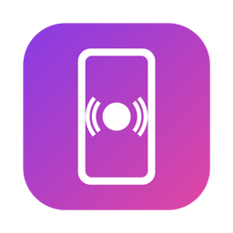
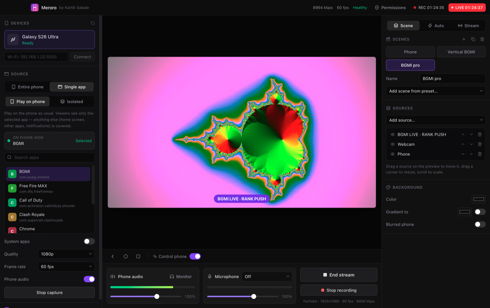
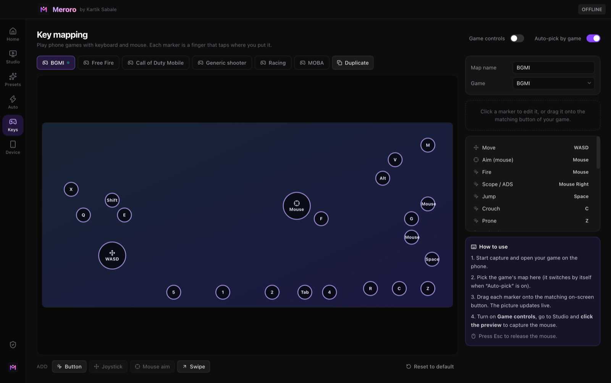
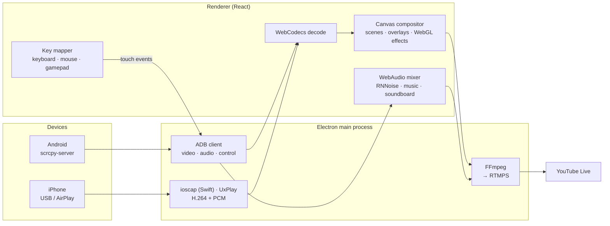

<div align="center">



# Meroro

**A desktop streaming studio for your Android phone and iPhone.**<br/>
Mirror your phone, or just one game, play it with keyboard and mouse, build animated scenes and go live on YouTube from a single app.

<p>
  
  
  
  
  
</p>

<p>
  <a href="#-features">Features</a> ·
  <a href="#-getting-started">Getting started</a> ·
  <a href="#-how-it-works">How it works</a> ·
  <a href="#-development">Development</a> ·
  <a href="#-faq">FAQ</a>
</p>

<sub>Designed and built by <b>Kartik Sabale</b></sub>

<br/><br/>



</div>

---

## Why Meroro

Streaming a mobile game usually means a capture card or a mirroring app, plus OBS, plus overlay plugins, plus a key-mapper. The whole phone goes on stream, notifications included. Meroro does all of it in one app:

- **Plug in, it's detected.** Nothing to install on an Android phone and no capture card needed. On an iPhone, use a USB cable (Mac) or AirPlay.
- **Stream one app, not your whole phone.** Pick your game and only that game is shown. The home screen, other apps and notifications are covered.
- **Play with keyboard, mouse or controller.** Key maps in the style of an emulator, with WASD, mouse aim, a free cursor when you open the map or bag, and screen triggers.
- **Overlays included.** 56 name banners, 60 animated stream scenes and 20 alert effects, all editable and imported in one click.
- **Scenes that switch themselves.** Open the game and the gameplay scene comes up. Go to the home screen and "Be right back" appears.

## ✨ Features

<table>
<tr>
<td width="50%" valign="top">

### 📱 Phone capture
- **Android:** uses the open-source **scrcpy** server over ADB. H.264 up to 1080p60, phone audio on Android 11+, USB or Wi-Fi.
- **iPhone / iPad:** USB capture on Mac, done the same way QuickTime does it. There is also a built-in **AirPlay receiver**.
- **Clean screen:** hides notifications, Game Booster pop-ups and floating apps on the phone while you stream. It restores everything afterwards.
- **Phone stats:** live CPU, GPU, RAM, temperatures and battery under the preview and on the Device page.

### 🎯 Single-app streaming
- **Play on phone:** keep playing on the device. Anything that isn't the selected app is covered on stream.
- **Isolated:** runs the app on a private virtual display, and you play it from the preview.
- **Add as source:** *Add source* shows the app that is open on the phone, with a one-click button.

### 🎮 Key mapping
- Taps, hold / toggle / repeat, joystick, mouse-aim (look), free look, skill cast and macros.
- Look sensitivity X/Y, acceleration and invert settings.
- **Free cursor:** the mouse is released while the map, bag or a crate is open.
- **Screen triggers:** the key map reacts to what is on screen.
- **Controller support** for Xbox and PlayStation pads, including analog sticks.
- Any key map can be used with any app, from the source settings or the bottom bar.

</td>
<td width="50%" valign="top">

### 🎬 Scenes & sources
Phone, iPhone, Webcam, Screen / Window, Image, Video, Web page, YouTube chat, Alert box, Text, Clock, Color, Lower third, Goal bar, Blur box and Nested scene.
- Drag, resize and rotate on the canvas, with **snap guides** and align buttons.
- **Green screen**, **.cube LUTs**, colour looks, crop, radius, border and shadow.
- Scene sizes for 16:9 and 9:16, applied to every scene at once.
- A preset picker for phone games, PC games and studio layouts.

### 🌈 Overlays
- **Name banners (56):** neon, slant, glass, cyber, esports and more. You can change the text, handles, font, colours, glow and animation, and add your own picture.
- **Stream scenes (60):** Starting soon, Ending and Be right back, with moving backgrounds and text effects.
- **Alert effects (20):** confetti, coin rain, neon, glitch and more. They can play for Super Chats, members, chat messages, stream start and subscribe reminders.

### 🔴 Live & record
- YouTube Live over RTMPS, or any RTMP server.
- **VideoToolbox** hardware encoding on Mac.
- **Auto-reconnect**, **auto bitrate** and a stream health graph.
- A **second output**, so you can send 9:16 to Shorts and 16:9 to the main stream at the same time.
- Local recording.

### 🎙️ Audio & chat
- Mixer with live levels and **RNNoise** noise suppression.
- Push-to-talk, background music that lowers while you talk, and a soundboard with global hotkeys.
- YouTube chat overlay in four styles, plus chat commands with bot replies.
- Automation rules for scene switching, alerts and timed reminders.

</td>
</tr>
</table>

Every feature is listed in the app on the **What's new** page, with a button that takes you to it. Meroro checks GitHub for new versions and updates itself.

### 🕹️ Ready-made game maps

| Game | Key map | Stream preset |
|---|---|---|
| **BGMI** | WASD + Shift sprint, mouse aim, peek, lean, heal, grenade, vehicle | Fullscreen + facecam · Clean · Title frame · Shorts |
| **Free Fire MAX** | WASD, mouse aim, gloo wall, skill, med kit | Fullscreen + facecam |
| **Call of Duty: Mobile** | WASD, mouse aim, slide, lethal, tactical, operator skill, scorestreak | Fullscreen + facecam |
| Racing games | Steer, gas, brake, nitro, drift | Any |
| MOBA games | Move stick, attack, skills 1–3, recall, heal | Any |

Any other game works with the generic maps or a map you build yourself.



## 🚀 Getting started

### Requirements
- macOS 12+ (Apple Silicon or Intel) or Windows 10/11.
- **Android:** a phone with **USB debugging** turned on (*Settings → Developer options*).
- **iPhone:** a cable (Mac only) or the same Wi-Fi network for AirPlay. The AirPlay receiver ([UxPlay](https://github.com/FDH2/UxPlay)) is installed from *Add source* with one click on Mac. On Windows, install UxPlay through MSYS2 yourself.

### Go live in five steps
1. Plug in your phone and tap **Allow** (Android) or **Trust** (iPhone).
2. Press **+** in Sources, choose **Android** or **iPhone / iPad**, or add the app that is open on the phone.
3. Add a scene from a preset, or import one from **Overlays**.
4. Turn on **Clean screen** and pick a key map if you want to play from the PC.
5. Paste your YouTube stream key in the **Stream** tab and press **Go Live**.

## ⌨️ Keyboard shortcuts

| Shortcut | Action |
|---|---|
| <kbd>⌘</kbd>/<kbd>Ctrl</kbd> + <kbd>1</kbd>–<kbd>9</kbd> | Switch scene |
| <kbd>⌘</kbd>/<kbd>Ctrl</kbd> + <kbd>R</kbd> | Start / stop recording |
| <kbd>←</kbd> <kbd>→</kbd> <kbd>↑</kbd> <kbd>↓</kbd> | Nudge the selected source |
| <kbd>Delete</kbd> | Remove the selected source |
| Scroll on preview | Scale the selected source |
| Right-click (control mode) | Phone *Back* |

Push-to-talk and soundboard keys are set in the **Sound** tab.

## 🧠 How it works



- **No middleman apps.** Meroro speaks the scrcpy protocol itself. It pushes the server, opens the video, audio and control sockets, and injects touches for key maps.
- **iPhone over USB.** A small Swift helper (`native/ioscap.swift`) turns on iOS screen capture devices, encodes them with VideoToolbox and sends H.264 and PCM to the app. AirPlay comes from UxPlay through local RTP.
- **Hardware decode.** Video goes into `VideoDecoder` and onto a canvas that composes every layer at the stream frame rate. Chroma key and LUTs run in WebGL.
- **One encode.** The composed canvas and mixed audio are captured once and sent to FFmpeg as H.264 High and AAC, with 2-second keyframes.
- **Foreground tracking.** Meroro polls which app is in front on the phone. That drives the single-app cover, auto scene switching and per-app key maps.

## 🛠️ Development

```bash
git clone https://github.com/kali23041/Meroro.git && cd Meroro
npm install          # also downloads adb, scrcpy-server, ffmpeg and builds ioscap on Mac
npm run dev
```

> If install scripts were skipped, run `node scripts/fetch-bins.mjs` once.

### Build installers
```bash
npm run dist:mac     # → dist/Meroro-<version>-mac-arm64.dmg  (on macOS)
npm run dist:win     # → dist/Meroro Setup <version>.exe      (on Windows)
```

Publish a GitHub release tagged `v<version>` with the installers attached, and existing installs will offer the update. Add new features to `RELEASES` in `src/renderer/src/WhatsNew.jsx`.

### Project structure

```
src/
├── main/                 Electron main process
│   ├── index.js            window, IPC, FFmpeg outputs, updates, YouTube sign-in
│   ├── phone.js            ADB + scrcpy client, phone stats, clean screen
│   ├── ios.js              iPhone USB capture, AirPlay receiver, RTP depacketizer
│   ├── chat.js             YouTube live chat reader and replies
│   └── splash.js           launch splash
├── preload/              secure IPC bridge
└── renderer/src/         React UI
    ├── App.jsx             studio layout, live logic, hotkeys, gamepad, free mouse
    ├── engine.js           decode, compositor, transitions, mixer, alerts
    ├── scene.js            scene/layer model, sizes, game presets
    ├── fx.js               banner, scene and alert animations
    ├── gpu.js              WebGL chroma key and LUTs
    ├── keymap.js · Keys.jsx   key mapper and editor
    ├── Overlays.jsx        overlay library and editor
    ├── Panel.jsx           scenes, sources, properties, automation
    ├── AddSource.jsx · Dialogs.jsx · PresetPicker.jsx
    ├── Perf.jsx · Device.jsx · Clean.jsx · Sounds.jsx · StreamPlus.jsx
    └── WhatsNew.jsx        release notes and updater
native/ioscap.swift       iPhone USB capture helper (macOS)
scripts/fetch-bins.mjs    downloads binaries, builds ioscap, draws the icon
```

### Tech stack

Electron · React 19 · Tailwind CSS v4 · Radix UI · Lucide · electron-vite · electron-builder · WebCodecs · WebGL · WebAudio · RNNoise · FFmpeg · scrcpy · ADB · AVFoundation / VideoToolbox · UxPlay

## ❓ FAQ

<details>
<summary><b>Do I need to install anything on my phone?</b></summary>
No. On Android, Meroro pushes the scrcpy server over ADB each time it connects. On iPhone, mirroring uses built-in iOS features.
</details>

<details>
<summary><b>Why is there no phone audio?</b></summary>
Android phone audio needs Android 11 or later. With iPhone USB capture, the audio comes with the video.
</details>

<details>
<summary><b>macOS asks for camera / screen / local network access. Why?</b></summary>
iPhone USB capture is treated as a camera by macOS. Screen and window sources need Screen Recording. Wi-Fi ADB and AirPlay need Local Network access.
</details>

<details>
<summary><b>Does Clean screen change my phone's settings permanently?</b></summary>
No. Meroro saves the previous settings and puts them back when you turn Clean screen off.
</details>

<details>
<summary><b>Can Meroro detect new YouTube subscribers?</b></summary>
YouTube's live chat doesn't report subscriptions, so the subscribe effect plays as a timed reminder. Super Chats, members and chat messages are detected live.
</details>

## 🙏 Credits

- Android capture uses the server from [**scrcpy**](https://github.com/Genymobile/scrcpy) by Genymobile (Apache 2.0).
- The AirPlay receiver is [**UxPlay**](https://github.com/FDH2/UxPlay) (GPL-3.0). It is installed separately and not bundled.
- Noise suppression uses [RNNoise](https://github.com/xiph/rnnoise) through [web-noise-suppressor](https://github.com/sapphi-red/web-noise-suppressor).
- FFmpeg comes from [ffmpeg-static](https://github.com/eugeneware/ffmpeg-static). ADB comes from the Android SDK Platform-Tools.
- BGMI, Free Fire, Call of Duty, YouTube, iPhone and AirPlay are trademarks of their owners. Meroro is an independent project and is not affiliated with them.

---

<div align="center">


**Meroro** · Created by **Kartik Sabale** · © 2026

</div>
